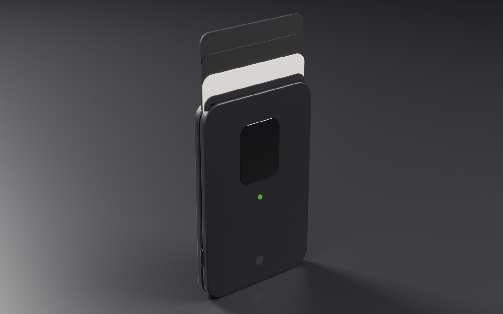
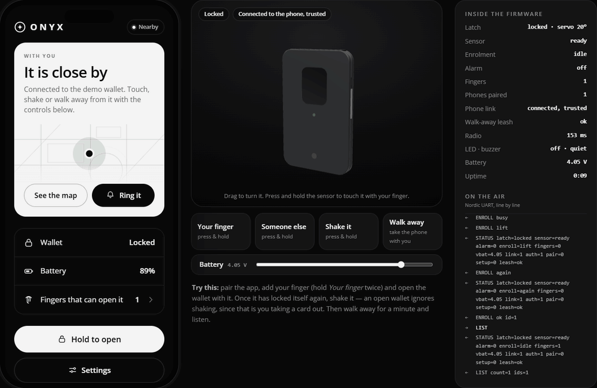
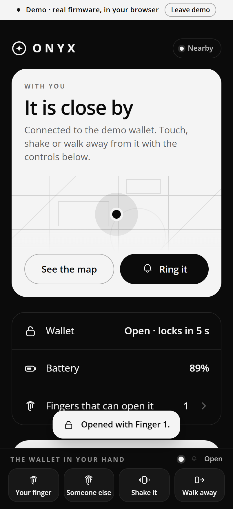
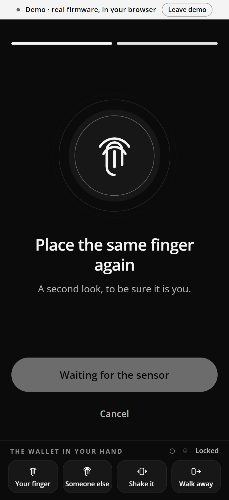
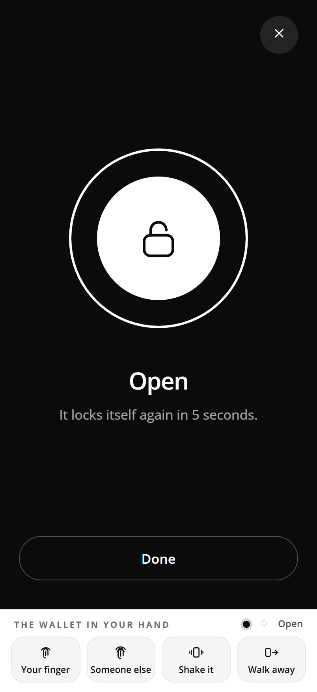
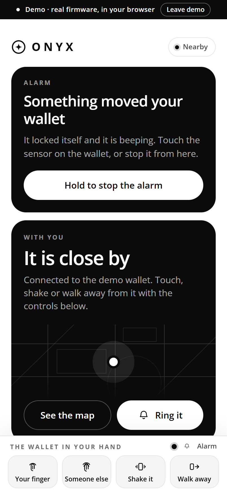
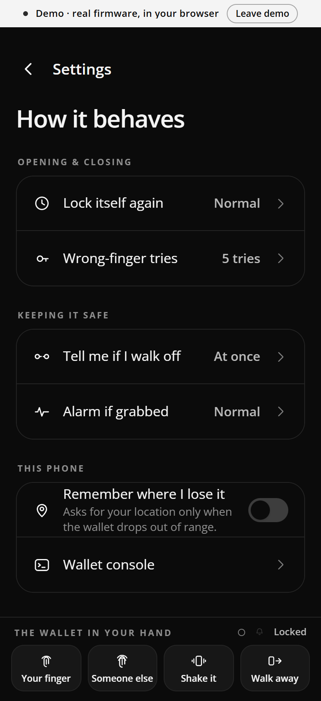
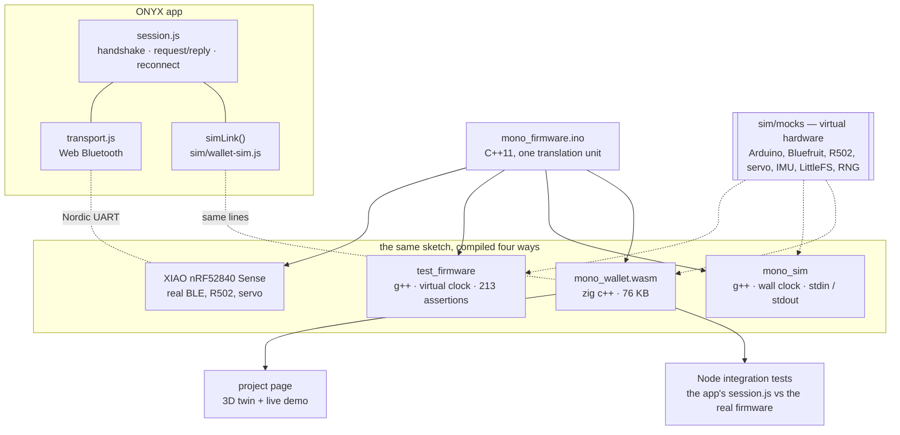
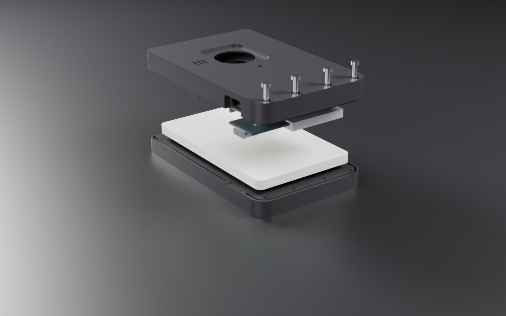
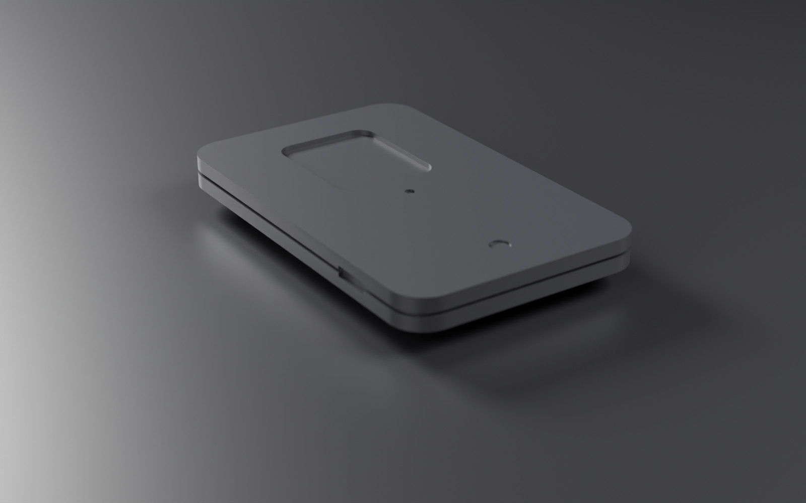

<div align="center">



# MONO

**A fingerprint wallet you can test without building one.**

[](https://github.com/Doufless1/MONO_prototype/actions/workflows/ci.yml)

[**Live demo**](https://doufless1.github.io/MONO_prototype/) ·
[Architecture](docs/ARCHITECTURE.md) ·
[Protocol](docs/PROTOCOL.md) ·
[Security](docs/SECURITY.md) ·
[Build one](docs/HARDWARE.md) ·
[Engineering review](docs/REVIEW.md)

</div>

MONO is a card wallet that opens for your finger and for your phone. A
thumb-sized nRF52840 board reads a fingerprint sensor, drives a servo latch,
feels for a grab through its IMU, and talks Bluetooth LE to **ONYX**, its
companion app. Walk off without it and the wallet notices.

The way it is built is the point: **`mono_firmware.ino` runs unmodified in
four places.** It runs on the board, in a C++ test suite on a virtual clock,
in a terminal simulator, and in your browser as 76 KB of WebAssembly, where
the app's own integration tests talk to it. Every bug fixed here was
reproduced first, and every fix a program can check is pinned by a test that
names it.

## Try it

The [live demo](https://doufless1.github.io/MONO_prototype/) runs the real
firmware in a browser tab, between the ONYX app and a 3D twin of the wallet.
The twin is drawn from the firmware's own outputs: the servo angle moves the
latch, the LED pin lights the LED, and the buzzer pin makes the sound waves.

<p align="center">
  
  <br><sub>Recorded from the live demo. A stranger's finger is refused. A grab sets off the alarm. The owner's finger stops it and opens the wallet.</sub>
</p>

1. **Pair.** A factory-fresh wallet accepts the first phone straight away.
2. **Add your finger.** Hold *Your finger* twice.
3. **Open it.** Hold *Your finger* again. The latch opens, then relocks itself after 6 seconds.
4. **Be a stranger.** Hold *Someone else* five times and the sensor locks out for 30 seconds.
5. **Grab it.** *Shake it* while it is closed: it goes into lockdown, beeps in bursts and speeds
   up its beacon. An open wallet ignores shaking, because that is you taking a card out.
6. **Leave it behind.** *Walk away*, then wait a minute.

<table>
  <tr>
    <td></td>
    <td></td>
    <td></td>
    <td></td>
    <td></td>
  </tr>
  <tr>
    <td align="center"><sub>Opened by a finger</sub></td>
    <td align="center"><sub>Enrolment, step two</sub></td>
    <td align="center"><sub>Hold to open</sub></td>
    <td align="center"><sub>Someone grabbed it</sub></td>
    <td align="center"><sub>Settings, in human units</sub></td>
  </tr>
</table>

To run it locally (Python 3, standard library only):

```bash
python tools/serve.py
```

Then open <http://localhost:8080/>. The app on its own is at
`/mono_app/?demo`. With a real wallet nearby, Chrome or Edge connects to it
over Web Bluetooth instead.

## How it fits together



There are three programs, and they have to agree with each other:

| | Stack | What it does |
|---|---|---|
| **Firmware** | Arduino C++11 on a Seeed XIAO nRF52840 Sense | Fingerprint matching on a GROW R502-A, servo latch, tamper detection on the IMU, a walk-away leash, a plain-text line protocol over the Nordic UART Service, and settings kept on flash behind a CRC |
| **ONYX app** | Vanilla ES modules, installable PWA, no build step | Web Bluetooth with a single write queue and 20-byte chunks, a session layer that matches requests to replies and reconnects with backoff, and screens that never claim more than the wallet has confirmed |
| **CAD** | Python: trimesh, shapely, manifold3d | Two parametric models with print-ready STLs, and a digital mock-up that assembles everything and checks how it goes together |

## What is worth a look

**Nothing blocks, and a test proves it.** `loop()` is a list of services. Each
one checks the clock and does a little work. Beeps come from a pattern player
with priorities; the servo is powered, moved, and detached later by a
deadline. The test harness hooks `delay()` and fails the build if anything
holds it for more than 20 ms, across a ring, an alarm, an unlock and an
enrolment.

**Outputs are derived, not switched.** The LED level and the advertising
interval are recomputed from the state on every pass. In v2, an alarm could
leave the radio beaconing every 20 ms until the next reboot, because nothing
switched it back. Now there is nothing to switch back
([REVIEW F14](docs/REVIEW.md#f14--after-an-alarm-the-radio-could-beacon-at-20-ms-forever--high-battery)).

**Hardware mocks that record what happened.** `sim/mocks/` replaces every
library the sketch includes. It records servo angles and servo power, every
beep, the LED pin, the advertising interval, and each line sent on each
transport. So a test can check that a tamper really drove the latch shut and
sped up the beacon, rather than checking what got printed. Fingers have
identities: enrol finger 1, and finger 1 opens the wallet while finger 2 is
rejected. Knocks are scheduled on the clock, which is how a test proves that
tamper detection no longer depends on what the loop is doing.

**The app is tested against the real firmware.** `session.test.mjs` drives the
app's session layer against `mono_firmware.ino` compiled to WebAssembly. The
session's timers run on the wallet's virtual clock, so the two advance
together. The tests are deterministic, and a 60-second walk-away takes
milliseconds.

**Security, including its limits.** On every connection the phone answers a
fresh 128-bit challenge with `HMAC-SHA256(key, "MONO-AUTH-1" ‖ nonce)`. The
wallet's SHA-256 is checked against the NIST and RFC 4231 vectors, and the app
uses WebCrypto. A new phone is approved by the owner's finger on the sensor.
The USB-C port is on the outside of the case, so the USB console is trusted
only while the wallet is unowned, or for a minute after the owner's finger
opens it.
[SECURITY.md](docs/SECURITY.md) also lists what the design does **not** stop:
sniffing the one-time key exchange, keys at rest, opening the case, reading
the chip over SWD, and fake fingers.

**CAD checked the same way as code.** `layout_b()` is the single source of
truth for Model B, so features that must line up are computed from one
another instead of typed in twice. In v1 they were typed twice, and the USB
slot ended up 30 mm from the board. `cad/dmu.py` assembles all 22 solids and
checks every pair for clashes (226 pairs). It also pushes a USB-C plug home
(6.25 mm engaged), slides the cards out through the mouth, traces the paths
the light and sound take, and checks that each screw passes freely through
one part and bites into the other.

## The engineering review

This repository went through two review passes. The second one reproduced
each suspected bug against the real code before calling it a bug, then
rebuilt each part around the fixes. All of it is in
[docs/REVIEW.md](docs/REVIEW.md), with the test that pins each fix.

| Area | Found | Fixed | Pinned by |
|---|---:|---:|---|
| Firmware | 22 | 21 (+1 by design) | 213 / 219 / 212 assertions across three builds |
| Companion app | 17 | 17 | 36 tests: 13 against the firmware as WebAssembly, 7 against a fake Bluetooth stack |
| CAD | 17 | 17 | 61 checks measured off the meshes, 24 of them from the mock-up |
| Repository | 3 | 3 | CI |

Some of what turned up:

- **Any phone in radio range could open the wallet.** `UNLOCK` needed no
  pairing and no authentication (F1).
- **Enrolling after a delete overwrote someone else's finger.** The next id was
  `count + 1`, so with fingers {2, 3} a new finger silently replaced finger 3 (F16).
- **A 310-character line starting with `DELETEALL ` wiped every fingerprint.**
  Overlong lines were truncated and then run (F9).
- **The battery read drove P0.14 high.** Seeed's own wiki warns that this can
  push the battery-sense pin past its 3.6 V limit (F10).
- **The USB-C slot was blind**, behind a 0.5 mm membrane, and the board it was
  meant for sat 30 mm away (C10).
- **Model A's two halves could not close.** The pin holes had been cut into
  thin air (C6).

## The hardware

<table>
  <tr>
    <td></td>
    <td></td>
  </tr>
  <tr>
    <td align="center"><sub><b>Model B, the works model.</b> 62 × 96 × 17.6 mm. Holds six ISO cards and all the electronics.</sub></td>
    <td align="center"><sub><b>Model A, the looks model.</b> 56 × 89 × 7.2 mm. The concept's proportions, for display.</sub></td>
  </tr>
</table>

Seeed XIAO nRF52840 Sense, GROW R502-A fingerprint module, a 1.7 g micro
servo, a ~200 mAh LiPo, an LED, a buzzer and four M2 screws. Every part prints
without supports. [docs/HARDWARE.md](docs/HARDWARE.md) covers the bill of
materials, wiring, print settings, assembly order, flashing and first boot.

## Run the tests

```bash
bash tests/run_all.sh
```

This needs g++ (any version with C++11), Python 3.12 with
`pip install -r cad/requirements.txt`, and Node 22 or newer. Zig is optional:
a prebuilt `sim/mono_wallet.wasm` is committed, and `sim/build_wasm.py`
rebuilds it.

| Suite | What it runs |
|---|---|
| `tests/test_firmware.cpp` | The sketch against the virtual hardware, in three builds: default, Find My compiled in, and the bench build |
| `tests/test_cad.py --regen` | Geometry checks on fresh meshes and the digital mock-up. Also proves the committed STLs are up to date, and that `N_CARDS_B` really drives the pocket depth |
| `tests/app/*.test.mjs` | The protocol layer; the session layer against the WebAssembly wallet; the Bluetooth transport against a fake GATT stack as strict as Chrome's; the offline shell |

CI runs all of these on every push to `main` and on every pull request. It
also runs a fourth job that compiles the sketch for the real board with
`arduino-cli`.
[tests/README.md](tests/README.md) explains how to drive the wallet by hand
from a terminal.

## Repository map

| Path | What it is |
|---|---|
| [`mono_firmware/`](mono_firmware) | The sketch, `config.h` (every pin and tunable), `sha256.h`, `findmy.h` |
| [`mono_app/`](mono_app) | The ONYX companion app |
| [`sim/`](sim) | The virtual wallet: mocks, the bench, the terminal simulator, and the WebAssembly build |
| [`cad/`](cad) | Generator, digital mock-up, STLs, assemblies, the concept model |
| [`site/`](site) | The project page: live demo, 3D twin, CAD viewer |
| [`tests/`](tests) | All the suites, plus `run_all.sh` |
| [`tools/`](tools) | Dev server, icon generator, Blender renders, scripted screenshots and the demo GIF |
| [`docs/`](docs) | Architecture, protocol, security, build guide, review |

## Limits

MONO is a prototype. The simulator shows that the logic is right; only a
bench can show that it works. The analogue side is untested here: real BLE
range, R502 match quality on real fingers, servo torque against a real latch,
current draw, and print fit after the plastic shrinks. The R502's height
(`R502_T`, 5.5 mm) is unverified. The BLE link is unencrypted unless you build
with `MONO_LINK_ENCRYPTION=1`. The Find My beacon is wired up but uses a
placeholder key.
