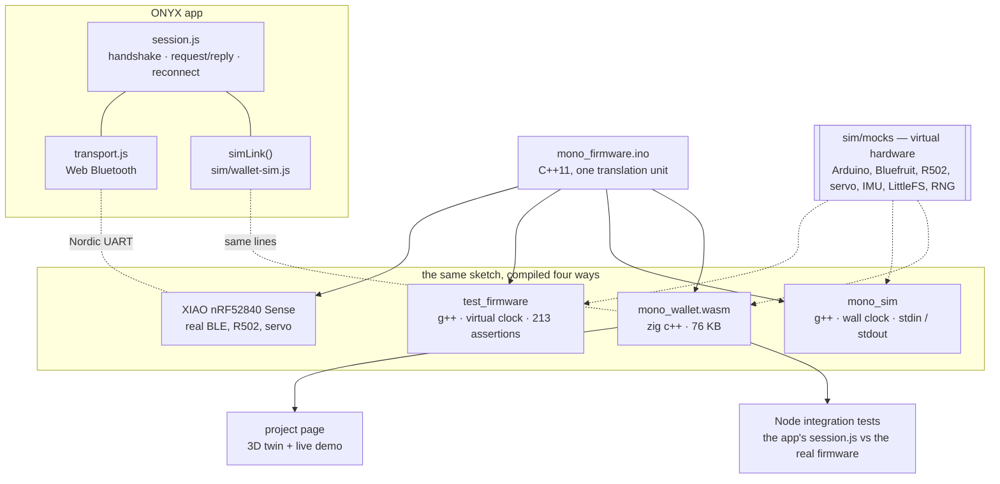
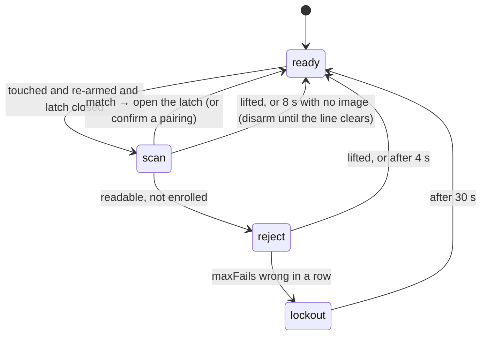
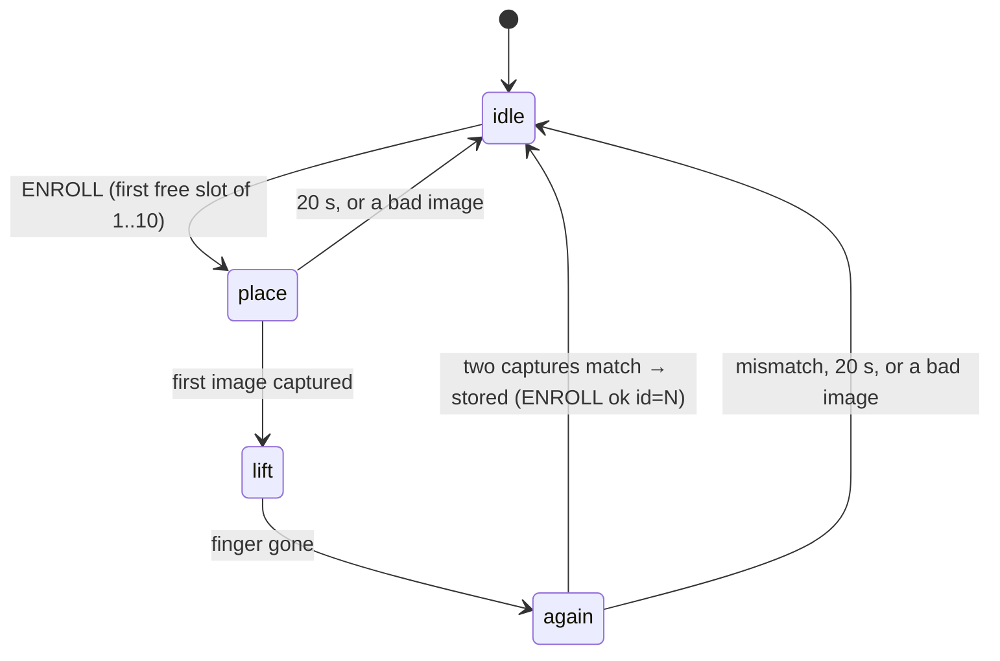
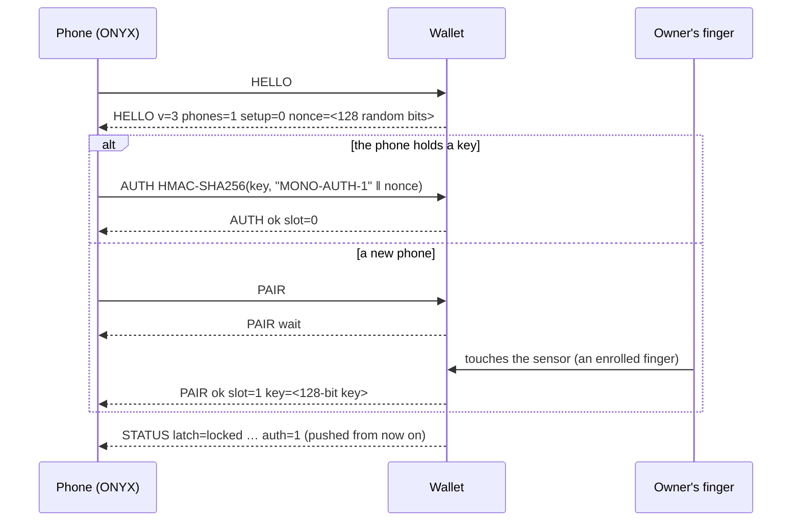
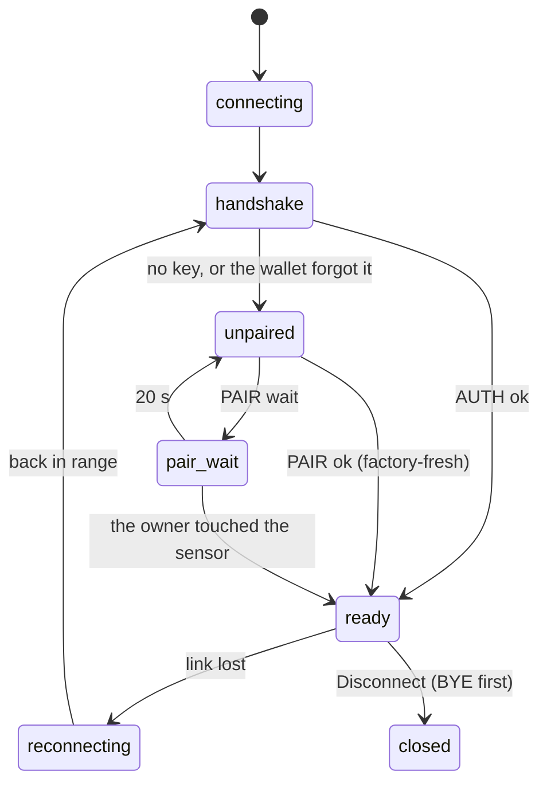

# Architecture

MONO is three programs that have to agree: firmware on the wallet, the ONYX
app on a phone, and the CAD that the wallet is printed from. The design goal
that shapes all three: **everything can be exercised without the hardware**,
and none of it through a copy — the firmware that is tested, simulated and
demoed is the exact file that is flashed.



## Repository map

| Path | What it is |
|---|---|
| `mono_firmware/` | The Arduino sketch: `mono_firmware.ino`, `config.h` (every pin and tunable), `sha256.h`, `findmy.h` |
| `sim/` | The virtual wallet: `mocks/` (scriptable, recording hardware), `bench.h` (the physical world), `mono_sim.cpp` (terminal), `wasm/` + `wallet-sim.js` (WebAssembly and its JS loader) |
| `mono_app/` | The ONYX companion app: installable, offline-capable, no build step |
| `cad/` | `mono_wallet_cad.py` (parametric generator), `dmu.py` (digital mock-up), `stl/` (print-ready parts), `assembly/` (GLB + part lists), `reference/` (the concept) |
| `site/` | The project page: live demo, 3D twin, CAD viewer |
| `tests/` | Firmware, CAD and app suites; `run_all.sh` runs them all |
| `tools/` | Dev server, icon generator, Blender renders, headless-Chrome screenshots and clips (`snap.mjs`, `gif.py`) |
| `docs/` | This, the [protocol](PROTOCOL.md), the [threat model](SECURITY.md), the [build guide](HARDWARE.md) and the [review](REVIEW.md) |

---

## Firmware

### One state, scheduled not blocked

All runtime state lives in one struct, `MonoState mono`. A power cycle is
`mono = MonoState()`, which is literally what the test harness does between
scenarios — so adding state can never leave a test reset incomplete.

`loop()` is a list of services, each of which looks at the clock and does at
most a little work:

```
serviceLinkEvents  pumpPorts  serviceBattery  serviceLatch  serviceEnroll
serviceSensor  serviceTamper  serviceAlarm  serviceLeash  servicePairing
serviceSound  serviceLed  serviceRadio  pushStatus  idle
```

Nothing calls `delay()` for effect. Beeps are a scheduled pattern player with
priorities (an alarm outranks a ring outranks a chirp); the servo is powered,
moved, and detached later by a deadline; `idle()` sleeps until the next
deadline and never longer than one 20 ms tamper sample. A recorder in the test
suite proves it: across a ring, an alarm, an unlock and an enrolment, no
`delay()` exceeds 20 ms.

Two outputs are **derived, never switched**: the LED level and the advertising
interval are recomputed from the state on every pass. That is the structural
fix for v2's beacon that could stay at 20 ms forever (REVIEW F14): there is no
"remember to switch it back" left to forget.

BLE callbacks only set flags (`linkEv`); `loop()` applies them. No state is
touched from two FreeRTOS tasks.

### The sensor



A lifted finger re-arms the sensor; a stuck wake line is scanned once, not
forever (F2). A poor image is a retry, not a wrong finger (F18). The same path
runs during a tamper lockdown, so brute force always counts (F5).

### Enrolment



Each step is reported as it happens (`ENROLL place / lift / again / ok`). The
new finger takes the first free slot from a map probed at boot — v2 used
`count + 1` and overwrote fingers after a delete (F16).

### Pairing and authentication



The key crosses the air once. Every later connection answers a fresh
challenge, so a recorded `AUTH` line is useless (*a recorded AUTH replayed
against a new nonce fails*). [SECURITY.md](SECURITY.md) has the threat model.

### Pushed status

`pushStatus()` snapshots everything the app shows and sends `STATUS` to the
trusted phone whenever it changes (battery in 50 mV steps, so noise does not
count). The app never has to guess which replies imply a refresh — the class
of bug behind the first review's A1 is gone, not patched.

---

## The virtual hardware

`sim/mocks/` replaces each library the sketch includes with a scriptable,
recording one. Three details make the tests meaningful:

- **`delay()` advances a virtual clock.** A 30-second lockout costs nothing in
  the test suite; the terminal simulator points the same hook at a real sleep.
- **Fingers have identities.** A template remembers which finger it was made
  from; a later touch matches only the same finger. "Enrol my thumb, then open
  with my thumb" works in the simulator for the same reason it works on the bench.
- **Knocks are scheduled on the clock.** `g_imu.jolt(t, 30)` is a 30 ms knock
  whatever the firmware's loop is doing — which is what lets a test prove that
  detection no longer depends on the loop (F7).

Everything a test or a twin needs to see is recorded: servo angle and whether
it is powered, every beep with its frequency and duration, the LED pin, the
advertising interval and connectability, every line sent to each transport.
`sim/bench.h` turns that into the physical world (`!touch 1`, `!shake on`,
`!link 0`) shared by the terminal simulator and the WebAssembly build.

---

## The app

| Module | Responsibility | Tested by |
|---|---|---|
| `protocol.js` | parse and build the line protocol; presets and their conversions; copy for failure reasons | unit tests |
| `crypto.js` | the AUTH answer, via WebCrypto | a Python-computed vector, and against the firmware |
| `transport.js` | Web Bluetooth: one GATT write at a time, 20-byte chunks, streaming decode, reconnect without the chooser | 7 tests against a fake GATT stack as strict as Chrome's, and the browser |
| `session.js` | one conversation: handshake, request/reply matching with timeouts, pushed state as DOM events, reconnect with backoff | 13 integration tests against the real firmware |
| `app.js` | screens and gestures | the browser, and `tools/snap.mjs` |

The session's timers run on an injected clock. In the integration tests that
clock is driven by the wallet's own virtual time, so the app and the firmware
advance together and a 60-second walk-away takes milliseconds — deterministic,
with no race between a real-time backoff and a virtual-time firmware.



The rule the screens follow: **nothing claims more than the wallet has
confirmed.** "Opening…" until `UNLOCK ok`; a spinner on a setting until
`SET ok`; a finger leaves the list when `LIST` says it is gone.

---

## The CAD

`layout_b()` is the single source of truth for Model B: every derived
dimension and every component position. The part builders, the component
envelopes and the mock-up all read it, so features that must line up — the
USB-C slot and the XIAO's receptacle, the latch window and the servo — are
computed from each other instead of typed twice (v1 typed them twice, and
they disagreed by 30 mm: REVIEW C10).

`cad/dmu.py` then assembles everything and measures, with exact booleans:
clashes across 226 pairs of solids, a USB-C plug pushed home, the card stack
swept out through the mouth, light and sound paths, the servo's reach into the
latch channel, screw clearance and thread engagement. The STLs are written in
print orientation; `cad/assembly/` keeps the assembled models, with a JSON
part list the project page uses to explode them.

The build is deterministic — two runs on one machine produce byte-identical
STLs — and the test suite rebuilds and compares, so the committed STLs can
never quietly fall behind the script. (Across operating systems the boolean
engine may differ in the last float bit, so there the comparison falls back to
volume, area and bounds; a real design change moves those by far more.)
