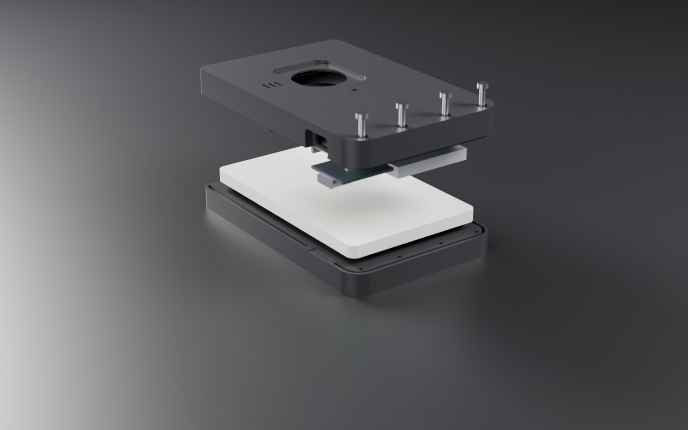
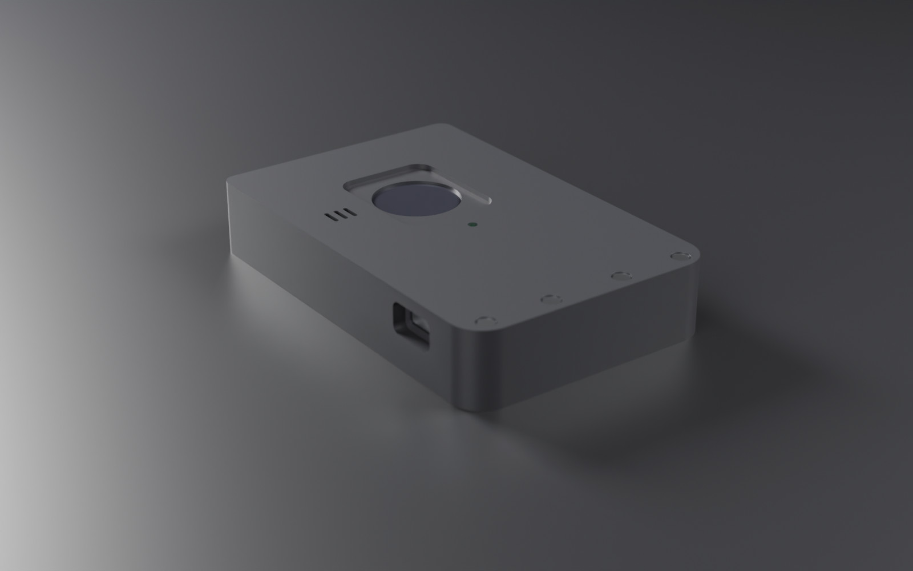

# Building one

Everything here is for **Model B**, the works model — the one that holds real
cards and real electronics. Model A is a display model of the concept: print
it, put four `A4_display_card.stl` in it, and close it.



## Bill of materials

| Part | Notes | Qty |
|---|---|---:|
| Seeed **XIAO nRF52840 Sense** | the non-mbed core; its IMU does the tamper detection | 1 |
| GROW **R502-A** fingerprint module | round, Ø22 mm; UART at 57600 | 1 |
| LiPo pouch, **402030** class (~200 mAh) | with a protection board; 30 × 20 × 4.2 mm envelope | 1 |
| **1.7 g micro servo** | must lie flat: its 6.5 mm side is vertical in a 7 mm bay | 1 |
| 3 mm LED + 330 Ω | the status LED | 1 |
| 9 × 9 mm passive buzzer | a piezo can hang off D4; a magnetic one needs an NPN and a flyback diode | 1 |
| **M2 × 12** self-tapping screws, pan head | Ø3.8 head | 4 |
| Double-sided foam tape, 1 mm | holds the LiPo and XIAO down | — |
| Six ISO/IEC 7810 cards | 53.98 × 85.60 × 0.76 mm | up to 6 |

Measure your parts before printing: every component dimension lives in the
`components` block of `cad/mono_wallet_cad.py`, and `R502_T` (5.5 mm) is
unverified — the R502-A's listings give its diameter but not its height.

## Wiring

| From | To | |
|---|---|---|
| R502 red (3V3), black (GND) | 3V3, GND | |
| R502 yellow (TX) | D7 (XIAO RX) | |
| R502 green (RX) | D6 (XIAO TX) | |
| R502 blue (WAKE) | D2 | the touch line |
| R502 white (Vt) | 3V3 | touch-detect power, ~2 µA |
| Servo signal | D3 | servo power from 3V3 or BAT, as your servo wants |
| Buzzer + | D4 | see the BOM note |
| LED + | D5 through 330 Ω | |
| LiPo | BAT pads | **check polarity** |

`config.h` holds the same table next to the pin numbers.

## Printing

Every STL in `cad/stl/` is already oriented for the bed.

| Part | Material | How | Why |
|---|---|---|---|
| `B1_works_back_cards` | PETG | **upright, on its bottom edge**, brim | the card slot prints as a vertical slot, smooth and with no bridge over the cards |
| `B2_works_front_electronics` | PETG | face down | the face is the bed's finish; the finger well bridges only short spans |
| `B3_component_tray` | PLA or PETG | face down, as exported | |
| `A1`, `A2` (looks model) | PLA | as exported, **2 perimeters forced** | |
| `A3_spring_clip` | **PETG** | as exported | it is a leaf spring |
| `A4_display_card` | PLA | flat; print four | the concept's card size, 52 × 84 mm |

0.2 mm layers, 0.4 mm nozzle, no supports anywhere. The fits assume
`FIT = 0.2 mm`; if your printer runs tight, raise it and re-run the generator.

## Assembly

1. **Flash first** (below), on the bench, with everything wired but loose.
2. Lay **B2 face down**. Push the **R502** into its bore from inside until it
   seats under the lip; its sensing window shows through the finger well.
3. Push the **LED** and the **buzzer** through their holes in the **tray**, so
   they will press against the inside of the front wall.
4. Drop the **tray** into the bay. The servo cut-out, the sensor hole, the LED
   hole and the buzzer hole line up with B2 by construction.
5. **Servo** into its cut-out, output end against the +X wall, facing the latch window.
6. **XIAO** into its pocket, USB-C toward the −X wall: the receptacle sits in the
   case's USB slot. **LiPo** into the pocket beside it. A dab of foam tape on each.
7. Route the wires through the notches in the pocket walls.
8. Load the cards into **B1** through its mouth; the nubs at the top hold them.
9. Close **B1** onto B2 — the tongue on B2 locates in B1's groove — and drive
   the four **M2 × 12** screws from the front. They pass freely through B2 and
   bite 4.3 mm into B1.

`python cad/dmu.py` checks every step of that in software first: 226 pairs of
solids for clashes, a USB-C plug pushed home (6.25 mm engaged), the cards slid
out through the mouth, the light, sound and latch paths, and the screws.

Closed, it is 62 × 96 × 17.6 mm:



## Flashing

```bash
arduino-cli config add board_manager.additional_urls https://files.seeedstudio.com/arduino/package_seeeduino_boards_index.json
arduino-cli core install Seeeduino:nrf52
arduino-cli lib install "Adafruit Fingerprint Sensor Library" "Seeed Arduino LSM6DS3"
arduino-cli board listall xiao
arduino-cli compile --upload -p <port> --fqbn <the Sense board from the list> mono_firmware
```

Or the Arduino IDE: add the URL under Preferences, install **Seeed nRF52
Boards** (the non-mbed entry), pick **Seeed XIAO nRF52840 Sense**, install the
two libraries.

At the bench, `-DMONO_BENCH=1` (or `#define MONO_BENCH 1` in `config.h`) lets
the USB console run every command. **Never carry a bench build.**

## First boot

1. Open a serial monitor at 115200. You should see `R502 online`, the battery,
   and `setup mode: nothing enrolled, nobody paired`.
2. Open the ONYX app (served over HTTPS or from localhost, in Chrome or Edge),
   tap **Pair a wallet**, pick MONO. A factory-fresh wallet pairs at once.
3. **Add your first finger**: two touches.
4. Tune the latch: `SET servolock <deg>` and `SET servorel <deg>` move the servo
   immediately, so you can find the angles with the case open.
5. A second phone pairs with **Pair a wallet** on that phone, then a touch of
   an enrolled finger on the wallet to say yes.

## Power

Measure before believing anything: a PPK2 or a meter in series with the
battery. The firmware sleeps between passes (`delay()` is FreeRTOS
`vTaskDelay()` on this core), so the real costs are elsewhere — in order:
the R502's main supply (always on as wired; a load switch would let only the
2 µA touch line stay up), the 50 Hz IMU polling (the LSM6DS3TR-C's wake-up
interrupt on INT1, P0.11, would replace it), advertising, and the ~3 µA
battery divider kept enabled because driving P0.14 high is unsafe.
